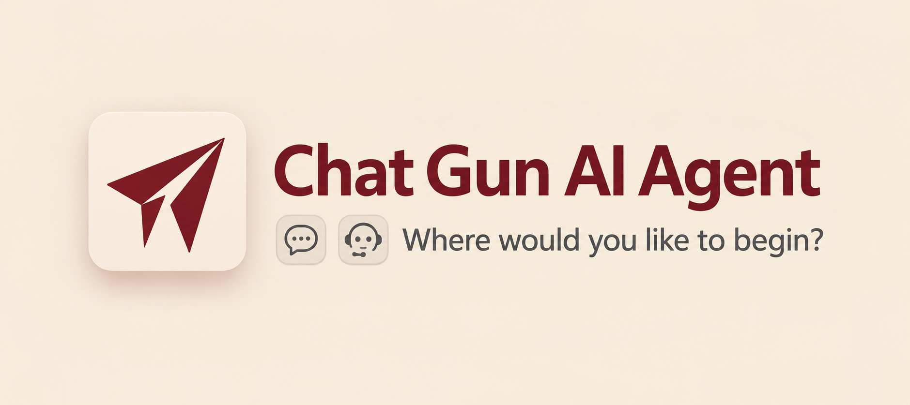
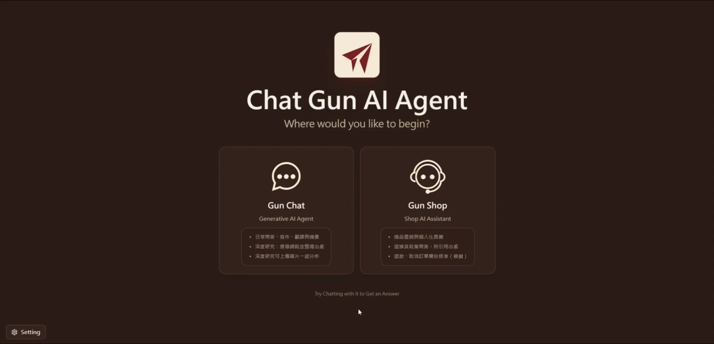
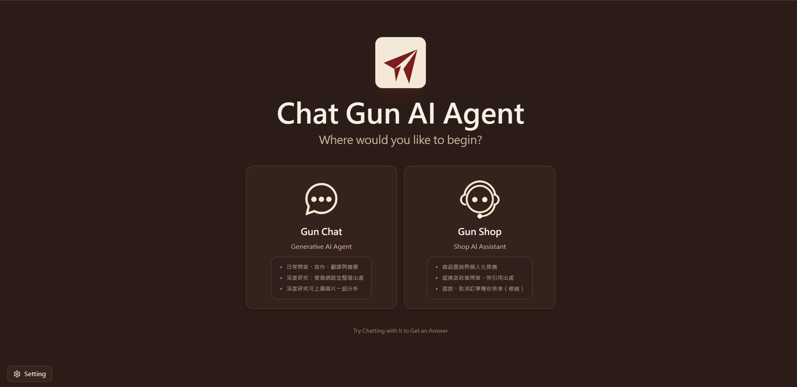
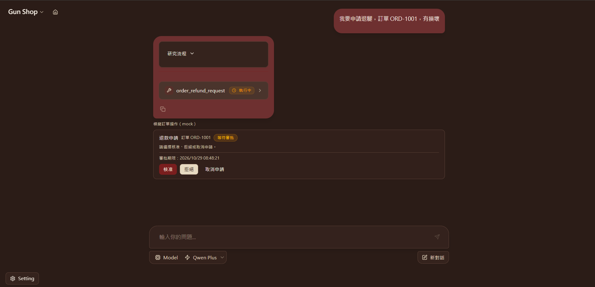
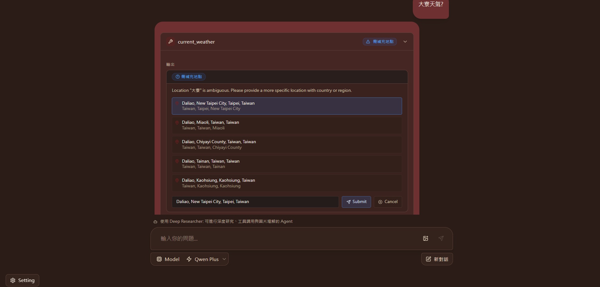

# Chat Gun

<p align="center">
  
</p>

[](./LICENSE)
[](https://langchain-ai.github.io/langgraphjs/)
[](https://opentelemetry.io/)
[](https://modelcontextprotocol.io/)
[](https://github.com/QwenLM/Qwen)
[](https://docs.tavily.com/documentation/api-reference/endpoint/search)
[](https://brave.com/search/api/)
[](https://github.com/comet-ml/opik)
[](https://github.com/Ylang-Labs/langgraph-react-agent-studio)

<p align="center">
  <a href="./README.en.md">English</a> |
  <a href="./README.md">繁體中文</a> |
  <a href="./README.zh-CN.md">简体中文</a>
</p>

Chat Gun 是一套以 React、TypeScript 與 LangGraph JS 建構的全端 Agent Chat 應用。它支援多 Agent 對話、串流回覆、Tool Calling、圖片輸入與 Human-in-the-Loop，並透過 BFF 統一處理瀏覽器與 LangGraph Runtime 之間的 API 流量。

## 核心功能

- **Agent-workflows**：
  - Deep Researcher 負責多步驟研究與引用驗證。
  - Chat Assistant 處理一般對話。
  - Math Solver 執行算式與數值運算。
  - MCP Agent 則透過 Tool Calling 使用 native 與 MCP tools。
- **Streaming**：即時串流回答與執行活動，並支援 Cancellation 與 Exception handling，讓使用者能中止進行中的請求並看見明確的錯誤狀態。
- **HITL**：天氣地點不明確時，Agent 會列出候選地點向使用者確認，再接續原本的 thread 執行。
- **Multimodal input**：接受 PNG、JPEG 與 WebP 圖片，透過 vision model 分析內容並納入回答或研究流程。
- **Native Tools**：內建計算、由 Tavily Search API 提供的網路搜尋、網頁擷取、目前天氣與天氣預報工具，Agent 可依問題選擇合適工具。
- **MCP integration**：可選擇載入 Filesystem 與 Brave Search MCP Server；Brave Search 以選配 MCP Tool 的形式擴充搜尋能力。
- **Agent／Tool SDK**：提供具型別的 Agent 與 Tool 宣告方式，並以版本化 manifest 描述輸入輸出、所需權限與執行條件。
- **Model providers**：支援 Qwen、OpenAI-compatible 與 CCR-compatible endpoints，統一由 LLM Gateway 處理模型能力與呼叫介面。
- **API Gateway**：BFF 集中處理 API key authentication、將已驗證 API key 映射為 Trusted Principal context、CORS、request size validation、Timeout、Cancellation propagation 與 Rate limiting；啟用驗證時，client 提供的 identity／tenant headers 不會被當成可信身分來源。
- **Observability & Evaluation**：提供 Metrics 與 OpenTelemetry，並可啟用 Opik tracing、versioned datasets 與 experiments 來追蹤及評估 Agent 行為。

> 📌
> 預設僅適用於本地開發。公開部署前，請啟用 Authentication、設定明確的 CORS allowlist、妥善管理 Secrets 與資料庫憑證，並依部署架構配置共享 Rate limiting、TLS 與 Reverse Proxy。若需要跨重啟或多實例恢復 Agent 執行，請改用 durable checkpointer。

## Demo

<p align="center">
  
</p>

<p align="center">
  
</p>

<p align="center">
  
</p>

<p align="center">
  
</p>

## 架構

```text
Browser
  -> frontend: Vite + React 19 + TypeScript
  -> bff: Node + TypeScript
  -> backend: LangGraph JS + TypeScript
  -> Model Provider / Native Tools / MCP Tools
```

| 目錄 | 用途 | 本地預設 port |
| --- | --- | ---: |
| `frontend/` | Chat UI、串流狀態、工具結果與圖片輸入 | `5173` |
| `bff/` | API gateway、驗證、代理、逾時與限流 | `8787` |
| `backend/` | LangGraph agents、模型整合、Tools 與 MCP | `2024` |

本地開發時，Frontend 會把 `/api/*` 代理至 BFF；LangGraph 請求經由 `/api/langgraph/*` 轉送到 Backend。模型、Tool 與 MCP credential 只保留在 Server 端。

```text
http://localhost:5173/app/
  -> http://127.0.0.1:8787/api/langgraph/*
  -> http://localhost:2024
```

## Agents

| Graph ID | 名稱 | 用途 |
| --- | --- | --- |
| `deep_researcher` | Deep Researcher | 深度研究、來源整理、工具調用、天氣查詢與圖片理解 |
| `chatbot` | Chat Assistant | 一般對話 |
| `math_agent` | Math Solver | 數學問題與運算 |
| `mcp_agent` | MCP Agent | 使用已啟用的 native／MCP tools |

Frontend 提供 `qwen-plus`、`qwen-max` 與 `qwen-turbo`，預設選用 `qwen-plus`。Backend 可針對不同 Agent 指定模型。

## 系統需求

- Node >= 22
- npm >= 10.8.x
- Qwen API key，或可用的 OpenAI-compatible／CCR-compatible endpoint
- Tavily Search API key（使用內建 `web_search` 時需要）
- Brave Search API key（啟用 Brave Search MCP Server 時需要，選用）
- Docker 與 Docker Compose（選用）

## 安裝

```bash
git clone https://github.com/HsienW/chat-gun.git
cd chat-gun

cd backend && npm ci
cd ../bff && npm ci
cd ../frontend && npm ci
cd ..
```

PowerShell：

```powershell
git clone https://github.com/HsienW/chat-gun.git
Set-Location chat-gun

Set-Location backend
npm ci
Set-Location ..\bff
npm ci
Set-Location ..\frontend
npm ci
Set-Location ..
```

## 設定

### Backend

從範例建立本地設定：

```bash
cp backend/.env.example backend/.env
```

PowerShell：

```powershell
Copy-Item backend/.env.example backend/.env
```

使用 Qwen 時，至少填入：

```env
LLM_PROVIDER=qwen
QWEN_API_KEY=your_qwen_api_key
```

Deep Researcher 的內建 `web_search` 使用 Tavily Search API：

```env
TAVILY_API_KEY=your_tavily_api_key
```

也可以連接其他模型端點：

```env
# OpenAI-compatible
LLM_PROVIDER=openai-compatible
OPENAI_COMPATIBLE_BASE_URL=https://your-endpoint.example/v1
OPENAI_COMPATIBLE_API_KEY=your_api_key
OPENAI_COMPATIBLE_MODEL=your_model

# CCR-compatible
LLM_PROVIDER=ccr
CCR_BASE_URL=http://127.0.0.1:3456/v1
CCR_API_KEY=your_api_key
CCR_MODEL=your_model
```

其他模型、圖片、天氣、Tool 與 MCP 設定請參閱 [`backend/.env.example`](./backend/.env.example)。不要將 API key 或其他 credential 提交到版本控制。

### BFF

```bash
cp bff/.env.example bff/.env
```

PowerShell：

```powershell
Copy-Item bff/.env.example bff/.env
```

| 環境變數 | 用途 |
| --- | --- |
| `BFF_LANGGRAPH_API_URL` | LangGraph API URL |
| `BFF_ALLOWED_ORIGINS` | 允許存取 BFF 的瀏覽器 origins |
| `BFF_REQUIRE_AUTH` | 是否要求 API key 或 Bearer token；啟用時還需要對應的 Trusted Principal profile |
| `BFF_API_KEYS` | 通常留空；若設定，每個 key 仍需有對應的 Principal profile |
| `BFF_API_KEY_PRINCIPALS_JSON` | 以 API key 為索引的 Principal profile JSON，包含 `principalId`、`principalType`、`tenantId`、`roles` 與 `scopes` |
| `BFF_LEGACY_HEADER_MODE` | 是否繼續向 Backend 傳送相容用的 `x-bff-user-id`；預設為 `true` |
| `BFF_MAX_BODY_BYTES` | Request body 上限 |
| `BFF_UPSTREAM_TIMEOUT_MS` | Upstream request timeout |
| `BFF_RATE_LIMIT_REDIS_URI` | Redis rate limiter；留空時使用 in-memory limiter |

其他 BFF 選項請參閱 [`bff/.env.example`](./bff/.env.example)。

啟用 BFF authentication 時，每個 API key 都必須具有 Trusted Principal profile；只設定 `BFF_API_KEYS` 會因缺少可信身分資料而回傳 `401`。BFF 會忽略 client 傳入的 `x-user-id`／`x-tenant-id`，並依 profile 產生及轉送 `x-bff-*` headers 至 Backend。Resource-level authorization 由需要保護的 Tool 或 workflow 顯式啟用。

```env
BFF_REQUIRE_AUTH=true
BFF_API_KEY_PRINCIPALS_JSON={"replace-with-a-long-random-key":{"principalId":"local-user","principalType":"user","tenantId":"local","roles":[],"scopes":[]}}
```

`BFF_API_KEY_PRINCIPALS_JSON` 的 JSON key 本身就是 credential，請只透過環境變數或 secret manager 提供，不要提交到版本控制。

### Frontend

本地開發不需要建立 `frontend/.env`。Frontend 預設使用同源 `/api/langgraph`；分開部署時可指定 BFF URL：

```env
VITE_LANGGRAPH_API_URL=https://api.example.com/api/langgraph
```

圖片輸入限制請參閱 [`frontend/.env.example`](./frontend/.env.example)。`VITE_*` 會出現在瀏覽器 bundle，不能用來保存 secret。

## 本地開發

分別啟動 Backend、BFF 與 Frontend。

```bash
# Terminal 1
cd backend
npm run dev
```

```bash
# Terminal 2
cd bff
npm run dev
```

```bash
# Terminal 3
cd frontend
npm run dev
```

開啟 <http://localhost:5173/app/>。

可使用 BFF 的健康檢查確認服務狀態：

```bash
curl http://127.0.0.1:8787/api/health
curl http://127.0.0.1:8787/api/ready
```

PowerShell：

```powershell
Invoke-RestMethod http://127.0.0.1:8787/api/health
Invoke-RestMethod http://127.0.0.1:8787/api/ready
```

`/api/ready` 會檢查 BFF 是否能連上 LangGraph Backend。

## Tools

| Tool | 用途 | 必要設定 |
| --- | --- | --- |
| `calculator_tool` | 算術運算 | 無 |
| `web_search` | Tavily Search API | `TAVILY_API_KEY` |
| `web_fetch` | HTTP／HTTPS 網頁擷取 | 無 |
| `current_weather` | Open-Meteo 目前天氣 | 無 |
| `weather_forecast` | Open-Meteo 天氣預報 | 無 |

可以使用 `TOOL_ALLOWLIST`、`TOOL_DENYLIST`、`TOOL_TIMEOUT_MS` 與個別 Tool 設定限制可用範圍。`web_fetch` 預設只允許 port `80`、`443`，並拒絕不安全的 private network address。

### 擴充 Agent 與 Tool

- TypeScript 開發者可使用以下 Tool
  - [`@gun-ai/harness-sdk`](https://www.npmjs.com/package/@gun-ai/harness-sdk) 的 `defineAgent`、`defineTool` 
    - 宣告 Agent 與 Tool，並透過版本化 manifest 指定資料格式、所需權限、執行環境與重試等條件。
    - 註冊時會驗證宣告；不完整或互相矛盾的設定會被拒絕。

  - [`@gun-ai/harness-testkit`](https://www.npmjs.com/package/@gun-ai/harness-testkit) 
    - 提供測試輔助工具。本專案使用 alpha 版本，擴充時請固定相容版本。

- 要在 Chat Gun 使用自訂 Tool，仍需在 Backend 接入實作並設定授權與執行環境；安裝 SDK 不會自動啟用 Tool，也不會略過既有的安全檢查。

## MCP

MCP tools 預設不會在啟動時載入。啟用 Filesystem MCP：

```env
MCP_LOAD_ON_START=true
MCP_FILESYSTEM_ENABLED=true
MCP_FILESYSTEM_PATH=/absolute/path/to/workspace
MCP_FILESYSTEM_ALLOWED_ROOTS=/absolute/path/to/workspace
```

讓 Deep Researcher 使用 MCP tools：

```env
DEEP_RESEARCHER_MCP_ENABLED=true
```

啟用選配的 Brave Search MCP Server：

```env
MCP_BRAVE_SEARCH_ENABLED=true
BRAVE_API_KEY=your_brave_api_key
```

`MCP_FILESYSTEM_PATH` 必須位於 `MCP_FILESYSTEM_ALLOWED_ROOTS` 內。多個 root 在 Windows 使用 `;` 分隔，在 Linux／macOS 使用 `:`。

## Observability

BFF 提供 metrics endpoint：

```bash
curl http://127.0.0.1:8787/api/metrics
```

OpenTelemetry 預設關閉。連接 OTLP collector：

```env
OTEL_ENABLED=true
OTEL_SERVICE_NAME=chat-gun
OTEL_EXPORTER_OTLP_ENDPOINT=http://localhost:4318
OTEL_EXPORTER_OTLP_PROTOCOL=http
OTEL_SAMPLE_RATE=1
```

Opik 可用於開發期間的 Agent tracing 與 Weather evaluation。它預設關閉；啟用 hosted tracing 時應使用非正式環境資料，並保持 redaction 開啟。

```env
OPIK_ENABLED=true
OPIK_API_KEY=your_opik_api_key
OPIK_WORKSPACE=your_workspace
OPIK_REDACT_ENABLED=true
```

執行 evaluation：

```bash
cd backend
npm run eval:opik
```

## Docker Compose

Docker Compose 會啟動 PostgreSQL、Redis、LangGraph API 與 BFF，並由 BFF 提供建置後的 Frontend。

在專案根目錄建立 `.env`：

```env
QWEN_API_KEY=your_qwen_api_key
TAVILY_API_KEY=your_tavily_api_key
LANGSMITH_API_KEY=your_langsmith_api_key_with_langgraph_cloud_access
```

Compose 使用的 LangGraph API 映像會驗證授權。若容器日誌顯示 LangSmith `/auth?langgraph-api=true` 回傳 403，請確認 `LANGSMITH_API_KEY` 所屬帳號具備 LangGraph Cloud 存取權，或依部署授權在 `langgraph-api.environment` 傳入 `LANGGRAPH_CLOUD_LICENSE_KEY`。

若憑證已設於 `backend/.env`，下列 `docker compose` 命令需加上 `--env-file backend/.env`。Docker 映像不會打包 `.env`；Compose 僅傳遞 LangSmith key 作為授權設定，關閉 LangSmith tracing，並依 `OPIK_*` 設定啟用 Opik tracing。Hosted tracing 僅適合已核准且完成資料遮蔽的環境。

應用持久化使用獨立的 `DATABASE_URL` 設定；`POSTGRES_URI` 是 LangGraph 伺服器的連線設定，不會配置應用的資料庫連線。首次執行時，先啟動 Compose PostgreSQL，將 `backend/.env` 的 `DATABASE_URL` 指向主機上的 PostgreSQL 埠 `5433`，再執行遷移：

```bash
docker compose up -d langgraph-postgres
npm --prefix backend run migrations:up
```

Compose 已在 `langgraph-api.environment` 傳入使用容器內 PostgreSQL 埠 `5432` 的 `DATABASE_URL`；本機 `backend/.env` 則使用主機埠 `5433`。

啟動服務：

```bash
docker compose up --build
```

開啟 <http://localhost:8123/app/>。

Compose 預設使用 Qwen。改用其他 provider 或啟用額外 Backend 功能時，請把對應環境變數加入 `docker-compose.yml` 的 `langgraph-api.environment`。

## 測試

Backend：

```bash
cd backend
npm run lint
npm run test
npm run build
```

BFF：

```bash
cd bff
npm run test
npm run build
```

Frontend：

```bash
cd frontend
npm run lint
npm run test
npm run build
```

## 疑難排解

### Frontend 出現 `Invalid URL`

`VITE_LANGGRAPH_API_URL` 必須是完整 URL。若 Frontend 與 BFF 使用同一個 origin，移除這個設定即可。

```env
VITE_LANGGRAPH_API_URL=http://localhost:5173/api/langgraph
```

### `/api/langgraph/*` 回傳 502

先確認 BFF 與 Backend 狀態：

```powershell
Invoke-RestMethod http://127.0.0.1:8787/api/ready
Invoke-RestMethod http://localhost:2024/ok
```

再檢查 `BFF_LANGGRAPH_API_URL` 是否指向正在執行的 LangGraph API。

### `Research synthesis failed ... fetch failed`

確認模型或 Tool provider 的 API key、base URL 與網路連線。使用 Qwen／Alibaba Cloud Bailian 時，可以先測試：

```powershell
Test-NetConnection dashscope.aliyuncs.com -Port 443
```

需要 proxy 時，在 `backend/.env` 設定 `HTTPS_PROXY`、`HTTP_PROXY` 與 `NO_PROXY`，然後重新啟動 Backend。

## 文件

- [BFF API Gateway](./docs/bff.md)
- [Agent 執行架構](./docs/architecture.md)
- [TypeScript + LangGraph 架構](./docs/typescript-langgraph-architecture.md)
- [Tool 與 MCP 安全設定](./docs/tool-security-isolation.md)

## License

Apache License 2.0。詳見 [LICENSE](./LICENSE)。
