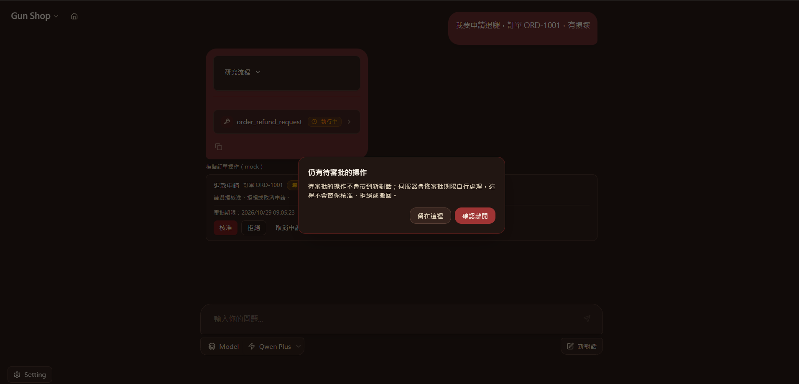

[← 回到 README](../README.md)

# Gun Shop 與使用入口

Chat Gun 是一套以 React、TypeScript 與 LangGraph JS 建構的全端 Agent 應用。它提供兩個使用入口：**Gun Chat** 處理一般對話、寫作與可選的深度研究；**Gun Shop** 示範一條完整的售後客服流程 — 商品查詢、帶出處的政策問答、退款與取消申請，以及需要人工核准後才會生效的訂單操作。

所有模型呼叫、工具執行與憑證解析都在 Server 端完成，瀏覽器只透過 BFF 與 LangGraph Runtime 通訊。工具統一經過 Tool Dispatch 執行，會改變外部狀態的操作必須先取得可持久化的人工核准，並以邏輯冪等鍵保證重複送出只生效一次。

## 入口與工作流程摘要

- **兩個使用入口**：
  - **Gun Chat** — 日常問答、寫作與翻譯。可開啟「深度研究」切換，改由研究流程搜尋網路並整理出處，也支援圖片輸入。入口選擇與切換由使用者操作決定，不需要額外的模型判斷。
  - **Gun Shop** — 商品查詢、退換貨與配送政策問答（帶出處），以及退款、取消訂單等需核准的模擬訂單操作。
- **Agent-workflows**：
  - Deep Researcher 負責多步驟研究與引用驗證。
  - Chat Assistant 處理一般對話。
  - Shopping Assistant 依意圖分流商品查詢、政策問答與訂單操作。
  - Math Solver 執行算式與數值運算。
  - MCP Agent 透過 Tool Calling 使用 native 與 MCP tools。
- **需核准的外部狀態變更**：退款與取消訂單屬於外部狀態變更類別，必須先取得可持久化的人工核准才會執行。模型只能「請求」核准，不能「記錄」核准。
- **冪等與去重**：冪等鍵由「操作種類＋訂單＋正規化後的明細」推導，不含重試次數或單次呼叫識別。同一筆邏輯操作重複送出只會生效一次，第二次可被辨識為「去重」而不是失敗。
- **可區分的操作狀態**：等待核准、執行中、已確認、已去重、失敗、生效前已取消、結果未知、核准被拒、核准逾期，九種狀態在介面上互相可辨識。提交後失去回應時進入「結果未知」並建立對帳任務，不盲目重試、不回報成功。

## 入口與 Agents

首頁提供兩個入口。入口決定使用哪一個 Agent，不需要額外的模型路由呼叫。

| 入口 | 對應 Agent | 說明 |
| --- | --- | --- |
| **Gun Chat** | `chatbot`；開啟「深度研究」時改為 `deep_researcher` | 日常問答、寫作、翻譯與摘要；深度研究會搜尋網路並整理出處，並可一併分析上傳圖片 |
| **Gun Shop** | `shopping_assistant` | 商品查詢與推薦、退換貨政策問答（附出處）、退款與取消訂單（需核准，模擬訂單） |

已註冊的 Graph：

| Graph ID | 名稱 | 用途 |
| --- | --- | --- |
| `deep_researcher` | Deep Researcher | 深度研究、來源整理、工具調用、天氣查詢與圖片理解 |
| `chatbot` | Chat Assistant | 一般對話 |
| `shopping_assistant` | Shopping Assistant | 商品查詢、政策問答與需核准的模擬訂單操作 |
| `math_agent` | Math Solver | 數學問題與運算 |
| `mcp_agent` | MCP Agent | 使用已啟用的 native／MCP tools |

首頁只會曝露 `chatbot`、`deep_researcher` 與 `shopping_assistant`；`math_agent` 與 `mcp_agent` 仍可註冊與直接呼叫，但不出現在介面上。

Frontend 的模型選單提供 `qwen-plus`、`qwen-max` 與 `qwen-turbo`，預設選用 `qwen-plus`。Backend 可針對不同 Agent 指定模型。

## Gun Shop 流程走查

這條流程把檢索、意圖分流、人工核准、冪等執行與狀態回報串成一次可觀察的對話。

1. **商品查詢** — 使用者描述需求。`shopping_assistant` 將意圖判為商品查詢，呼叫一次 `kb_search`（來源類型限定商品），結果以商品卡片呈現，而不是用文字列舉。
2. **政策問答** — 使用者詢問退換貨或配送規則。流程強制「檢索 → 引用驗證 → 合成」；每個引用都必須能解析回已儲存的語料片段。語料中沒有依據時，明確回覆查無來源，不改用模型自身知識作答。
3. **退款申請** — 意圖判為訂單操作，呼叫 `order_refund_request`。該工具宣告為外部狀態變更、需要人工核准，並附帶一個由邏輯操作推導的冪等鍵。
4. **人工核准** — 介面出現核准卡片。核准紀錄由 Server 端持久化保存，與觸發它的對話綁定，只能被消費一次。核准被拒、核准逾期、生效前取消，三者產生不同的終端狀態。
5. **冪等執行** — 核准通過後才會提交副作用，並在 ledger 留下一筆紀錄。同一筆邏輯操作重複送出只會生效一次；第二次會被辨識為「去重」並指向原操作。
6. **狀態回報** — `order_operation_status` 從核准紀錄與 ledger 讀出目前狀態，以狀態卡片呈現。狀態不從助理的文字描述重建。

操作生命週期的可見狀態：

| 狀態 | 意義 |
| --- | --- |
| `awaiting_approval` | 已送出申請，等待人工核准 |
| `approval_denied` | 核准被拒，副作用未發生 |
| `approval_expired` | 核准逾期，副作用未發生 |
| `cancelled_before_effect` | 使用者在副作用發生前取消 |
| `executing` | 已核准，正在提交 |
| `confirmed` | 副作用已確認提交 |
| `deduplicated` | 同一筆邏輯操作已提交過，本次為去重 |
| `failed` | 操作失敗且副作用未提交 |
| `outcome_unknown` | 提交後失去回應，已建立對帳任務，不盲目重試 |

此版本**不提供任何還原（undo）操作**。`cancelled_before_effect` 代表「副作用從未發生」，與「已發生後被補償」是不同的語意，後者在此版本不存在。

## 操作畫面

  

  

  

## 並行與回歸驗證

Backend 的 `lint` 包含資料庫遷移的相容性檢查與 TypeScript 檢查。並行重複送出的去重、核准逾期與取消競態都有整合測試覆蓋，其中並行案例以實際並行送出驗證，而非依序呼叫。

測試入口：[並行冪等整合測試](../backend/src/runtime/side-effect/business-effect-ledger.integration.test.ts)、[流程整合測試](../backend/src/evaluation/commerce/chain-runner.integration.test.ts)。完整 deterministic 與 live 結果及其限制見[評測](./evaluation.md#流程評測)。
