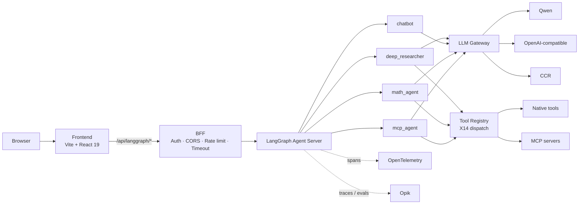

# Design：readme-architecture-diagram

## 責任邊界

本 change 只修改三份 README 的架構章節。frontend、bff、backend 皆無程式變更：

- **frontend**：無變更。
- **bff**：無變更。
- **backend**：無變更。
- **Tool／MCP**：無變更，因此不涉及新的權限或安全面。

本 change 不涉及執行期行為，因此 `openspec/config.yaml` 要求的逾時、取消情境，以及重試、串流與 Tool 權限情境皆不適用；spec 以「渲染失敗」與「結構漂移」作為失敗情境。

## 圖的內容與程式碼依據

圖中每個節點與邊都必須能在程式碼中找到依據。以下為 plan-change 階段 CCR 唯讀核對的結果，Codex 施工前應再確認一次，若不符須回報而非自行修改圖。

| 圖上元素 | 依據 |
|---|---|
| 四個 Graph 節點 | `backend/langgraph.json` 的 `graphs` |
| Frontend → BFF 經 `/api/langgraph/*` | README 現有說明段落與 BFF 代理路由 |
| 四個 Graph → LLM Gateway | 四個 agent 皆匯入 `platform/llm-gateway` |
| LLM Gateway → Qwen／OpenAI-compatible／CCR | `LlmProviderName = "ccr" \| "openai-compatible" \| "qwen"` |
| `deep_researcher`、`math_agent`、`mcp_agent` → Tool Registry | 三者皆匯入 `tools/registry`；`chatbot` 沒有 |
| Tool Registry → Native tools、MCP servers | `tools/registry` 與 MCP loader |
| LangGraph Agent Server ⇢ OpenTelemetry、Opik | `platform/tracing/` 只在 backend |

## 標準圖

英文版 README 原樣使用；其他兩份只替換「在地化標籤」表中的標籤。

結構：17 個節點、21 條邊（19 條實線、2 條虛線）。

## 在地化標籤

只替換下列標籤；節點 ID、邊、其他標籤一律不變。

| 節點 | 繁中版 | 简中版 |
|---|---|---|
| B | 瀏覽器 | 浏览器 |
| G | BFF 認證 · CORS · 限流 · 逾時 | BFF 认证 · CORS · 限流 · 超时 |
| NT | 原生工具 | 原生工具 |

邊上的標籤、BFF、LangGraph、LLM Gateway、Tool Registry、四個 Graph ID 與 Provider 名稱三份皆保持英文。

## 圖上方說明句

- 繁中：下圖說明一個請求從瀏覽器到模型供應商會經過哪些層，以及可觀測性接在哪裡。
- 英文：This diagram shows the layers a request passes through from the browser to the model provider, and where observability attaches.
- 简中：下图说明一个请求从浏览器到模型供应商会经过哪些层，以及可观测性接在哪里。

## 語法規則

- 含空格、斜線、括號或 ` ` 的標籤一律加雙引號。
- 不使用 `A & B --> C` 簡寫，每條邊各寫一行。
- 不使用 emoji。

## 替代方案

| 方案 | 不採用理由 |
|---|---|
| 保留 ASCII 圖 | 無法表達多 Graph、共用 Gateway 與可觀測性分支 |
| 圖片檔（PNG／SVG） | 無法 diff，三語版本難以保持一致 |
| 依 Fast Lane 原草圖照畫（含 `kb_search`） | 畫出尚未實作的能力，違反 Fast Lane「不得畫出尚未存在的東西」 |
| 每個 Graph 連到的具體 Tool 都畫出來 | 圖過於細碎，且會隨 Tool 增減頻繁失準；細節留給 Tools 章節 |

## 風險

- **首次使用 Mermaid**：GitHub 渲染只能在推送後確認，本地預覽不作為驗收依據。
- **長期準確性**：新增 Graph、Provider 或 Tool 路徑時，圖不會自動更新。本 change 不建立自動檢查，記錄為後續建議。
